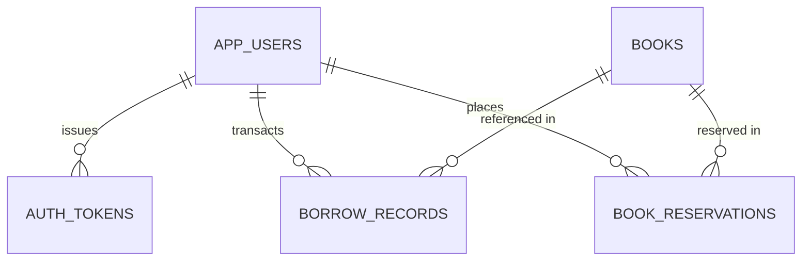

# 📖 PageTurn — Advanced Library Book Search, Recommendation & Role-Based Management System

[](https://openjdk.org/)
[](https://spring.io/projects/spring-boot)
[](https://www.postgresql.org/)
[](https://supabase.com/)
[](#role-based-access-control-rbac)
[](#-advanced-data-structures--algorithms-adsa)

An enterprise-grade, high-performance Library Management and Recommendation System built with **Java 21 Spring Boot**, **Supabase PostgreSQL**, in-memory **Advanced Data Structures (Trie, BST, ConcurrentHashMap)**, and a modern, responsive web portal.

Features deterministic **Role-Based Access Control (Admin & Student)**, exclusive Admin student registration management, student self-service dashboards with real-time due date tracking, automated transaction linking, book reservations/holds, and fine policy enforcement.

---

## 🏛️ System Architecture

```mermaid
graph TD
    Client[Web Client Browser / Live Server] -->|RESTful JSON + Bearer Token| Gateway[Spring Boot Controller Layer]
    Gateway --> Interceptor[AuthInterceptor: RBAC & Token Guard]
    Interceptor --> Service[Service Layer: Business Logic & Rules]
    
    Service -->|O(1) / O(L) In-Memory Queries| DSA[BookSearchIndex: Trie, BST, HashMap]
    Service -->|ACID Transactions| ORM[Spring Data JPA / Hibernate]
    ORM --> Pooler[Supabase Session Pooler: PgBouncer]
    Pooler --> DB[(PostgreSQL 17 Database)]
```

---

## ✨ Key Features

### 1. Dual-Role Authentication & Security
- **Dedicated Portals**: Dual-tab authentication interface for **Student Portal** and **Admin Portal**.
- **No Public Student Registration**: Student accounts are provisioned exclusively by the Administrator.
- **Cryptographic Hashing**: User passwords hashed using **BCrypt** with adaptive work factor ($2^{10}$ iterations).
- **Bearer Session Management**: 14-day token-based sessions validated by Spring's `HandlerInterceptor` on every request.

### 2. Administrator Controls & Student Directory
- **Exclusive Student Registration**: Register students with Student ID/Roll number, Full Name, University Email, Phone, Department, and an initial password.
- **Account Status Management**: Instant **Active / Deactivated** toggling. Deactivating an account revokes all active session tokens immediately.
- **Administrative Utilities**: Password resets, student search & filtering, borrow history auditing, and loan reminder notices.
- **Catalog Management**: Add, update, delete book records, and seed demo collections.

### 3. Student Self-Service Dashboard
- **Active Loans & Due Tracker**: View currently borrowed books with cover previews and dynamic countdown status pills:
  - `✓ Due in X days` (Emerald)
  - `⚠️ Due Today` / `⏳ Due in X days` (Amber pulse)
  - `⚠️ Overdue by X days · Late Fine: ₹XX` (Red pulse)
- **One-Click Returns**: Students can return borrowed books directly from their personal dashboard.
- **Book Reservations (Holds)**: If a book has 0 available copies, students can place a 7-day pickup reservation.
- **Borrowing History**: Complete log of all past returned and borrowed volumes with fine status.

### 4. Automated Borrowing Linking & Fine Policy
- **Automatic Linking**: Every borrow checkout (`POST /api/student/borrow` or `/api/borrows`) automatically binds the authenticated student's `studentId`, full name, and student ID number.
- **Fine Policy Enforcement**:
  - Late fee rate: **₹10 / day** past due date.
  - Lost book fee: **₹500** replacement fee.
  - **Zero-Tolerance Fine Rule**: Borrowing is automatically blocked if the student has uncleared fines.

---

## ⚡ Advanced Data Structures & Algorithms (ADSA)

All search algorithms are implemented in [`BookSearchIndex.java`](src/main/java/com/library/dsa/BookSearchIndex.java) to eliminate disk-bound database latency:

### 1. Trie (Prefix Tree) for Sub-Millisecond Autocomplete
- Indexes all book titles character-by-character.
- Prefix search executes in $O(P)$ time ($P = \text{prefix length}$) followed by a Depth-First Search (DFS) with backtracking to collect up to $K$ suggestions.
- **Average Time Complexity**: $O(P + K \cdot \bar{L})$ vs $O(N \cdot M)$ for database substring scans.

### 2. Binary Search Tree (BST) for Lexicographical Sorting
- In-memory binary tree where $\forall x \in \text{Left}(N): x < N$ and $\forall y \in \text{Right}(N): y > N$.
- Recursive **In-Order Traversal** (**Left $\to$ Root $\to$ Right**) provides sorted titles in $O(N)$ time with $O(H)$ stack space without requiring an SQL `ORDER BY` query.

### 3. ConcurrentHashMap for $O(1)$ ISBN Lookups
- Key-value mapping of ISBNs using `ConcurrentHashMap` with thread-safe bucket trees for $O(1)$ amortized lookups.

| Operation | Algorithm / Data Structure | Time Complexity (Avg) | Space Complexity |
|---|---|---|---|
| Prefix Autocomplete | In-Memory Trie + Backtracking DFS | $O(P + K \cdot \bar{L})$ | $O(N \cdot \bar{L} \cdot \|\Sigma\|)$ |
| Alphabetical Sort | BST In-Order Traversal | $O(N)$ | $O(H)$ recursion stack |
| ISBN Lookup | ConcurrentHashMap | $O(1)$ | $O(N)$ |

---

## 🗄️ Database Management Systems (DBMS)

Managed via PostgreSQL 17 on Supabase ([`supabase/schema.sql`](supabase/schema.sql)):



- **3NF & BCNF Normalization**: Surrogate primary keys (`BIGINT GENERATED BY DEFAULT AS IDENTITY`) eliminate partial key dependencies.
- **Integrity Constraints**: Foreign keys on `auth_tokens` and `book_reservations` utilize `ON DELETE CASCADE`.
- **Indexing Engineering**: High-frequency query columns are indexed using B-Trees (`idx_books_title`, `idx_user_username`, `idx_token_value`, `idx_borrow_student_id`, `idx_res_student`).
- **ACID Transactions**: Spring's `@Transactional` guarantees atomicity across stock decrementing and record creation.
- **Connection Pooling**: Supabase PgBouncer session pooling on port 5432 prevents socket exhaustion.

---

## 🔌 RESTful API Endpoints

### Authentication (`/api/auth`)
| Method | Endpoint | Access | Description |
|---|---|---|---|
| `POST` | `/api/auth/login` | Public | Authenticates credentials and returns Bearer token |
| `GET` | `/api/auth/me` | Authenticated | Retrieves current authenticated user profile |
| `POST` | `/api/auth/logout` | Authenticated | Revokes session token |

### Student Portal (`/api/student`)
| Method | Endpoint | Access | Description |
|---|---|---|---|
| `GET` | `/api/student/dashboard` | Student | Retrieves dashboard metrics, active loans, and reservations |
| `GET` | `/api/student/loans` | Student | Lists current active loans with real-time due dates |
| `GET` | `/api/student/history` | Student | Lists all past and present loan records for the student |
| `POST` | `/api/student/borrow` | Student | Borrows a book (auto-linked to student account) |
| `POST` | `/api/student/return/{id}` | Student | Returns a borrowed book |
| `GET` | `/api/student/reservations` | Student | Lists student's reservations |
| `POST` | `/api/student/reservations` | Student | Reserves an out-of-stock book |
| `POST` | `/api/student/reservations/{id}/cancel` | Student | Cancels a pending reservation |

### Admin Student Management (`/api/admin/students`)
| Method | Endpoint | Access | Description |
|---|---|---|---|
| `GET` | `/api/admin/students` | Admin | Lists all registered students with loan and fine statistics |
| `POST` | `/api/admin/students` | Admin | Registers a new student account |
| `GET` | `/api/admin/students/{id}` | Admin | Retrieves student profile details |
| `PUT` | `/api/admin/students/{id}` | Admin | Updates student details |
| `PATCH` | `/api/admin/students/{id}/status` | Admin | Toggles status between `ACTIVE` and `DEACTIVATED` |
| `POST` | `/api/admin/students/{id}/reset-password` | Admin | Resets a student's password |

### Books & DSA (`/api/books`, `/api/dsa`)
| Method | Endpoint | Access | Description |
|---|---|---|---|
| `GET` | `/api/books` | Public | Search catalog by title, author, category, or ISBN |
| `POST` | `/api/books` | Admin | Creates a new book entry |
| `PUT` | `/api/books/{id}` | Admin | Updates book details |
| `DELETE` | `/api/books/{id}` | Admin | Removes a book from catalog |
| `POST` | `/api/books/seed` | Admin | Populates demo books if collection is empty |
| `GET` | `/api/dsa/suggest?prefix=` | Public | Trie prefix autocomplete suggestions |
| `GET` | `/api/dsa/sorted-titles` | Public | BST in-order alphabetical title traversal |

---

## 🚀 Getting Started

### Prerequisites
- **Java 21+** (JDK 21 or newer)
- **Maven 3.9+**
- **Git**
- PostgreSQL database or free [Supabase](https://supabase.com) project

### 1. Clone Repository
```bash
git clone https://github.com/sakksham9/LIBRARY.git
cd LIBRARY
```

### 2. Environment Configuration
Create a `.env` file or export environment variables:
```powershell
$env:DB_URL = "jdbc:postgresql://YOUR_SUPABASE_HOST:5432/postgres?sslmode=require"
$env:DB_USERNAME = "postgres.YOUR_PROJECT_REF"
$env:DB_PASSWORD = "YOUR_DATABASE_PASSWORD"
```

### 3. Run the Backend
Using the automated PowerShell runner:
```powershell
powershell -ExecutionPolicy Bypass -File .\run.ps1
```
Or directly with Maven:
```powershell
mvn spring-boot:run
```
The server will start at `http://localhost:8080`.

### 4. Open Frontend Portal
Visit `http://localhost:8080` in any web browser.

---

## 🔑 Default Credentials

The system automatically initializes default accounts upon first startup:

| Portal | Username / ID | Password | Role |
|---|---|---|---|
| **Admin Portal** | `admin` | `admin123` | Library Administrator |
| **Student Portal** | `student` *(or `STU-2026-001`)* | `student123` | Student (Saksham Munda) |
| **Student Portal** | `aarav` *(or `STU-2026-002`)* | `aarav123` | Student (Aarav Sharma) |

*Tip: The Sign In dialog includes 1-click quick fill buttons for instant demonstration.*

---

## 📁 Project Structure

```
├── pom.xml                                    # Maven dependencies & build configuration
├── run.ps1                                    # PowerShell startup script with DB environment
├── README.md                                  # Project documentation
├── supabase/
│   └── schema.sql                             # Reference PostgreSQL schema with indexes
├── src/main/java/com/library/
│   ├── LibraryRecommendationApplication.java # Spring Boot main entrypoint
│   ├── book/                                  # Book catalog entity, service, & controller
│   ├── borrow/                                # Borrow transaction entity, service, & controller
│   ├── reservation/                           # Book reservation entity, service, & controller
│   ├── user/                                  # User & Token entities, auth & student controllers
│   ├── security/                              # AuthInterceptor (RBAC & Bearer verification)
│   ├── config/                                # CORS & SecurityBeans (BCrypt) configuration
│   └── dsa/                                   # In-memory Trie, BST, and HashMap algorithms
├── src/main/resources/
│   ├── application.properties                 # Spring Boot application properties
│   └── static/                                # Packaged frontend web application
└── frontend/                                  # Source HTML, CSS, JavaScript files
```

---

## 📄 License
This project is open-source and available under the [MIT License](LICENSE).
